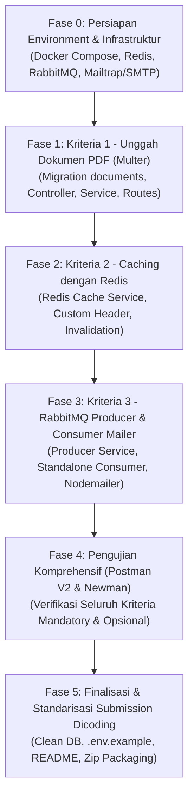

# IMPLEMENTATION PLAN: OPENJOB RESTFUL API VERSI 2 (TARGET BINTANG 5)

## 1. Ringkasan Eksekutif & Target Penilaian
Proyek ini merupakan kelanjutan dari **OpenJob RESTful API Versi 1** menuju **Versi 2**.
Target utama adalah **Bintang 5 (Skor 4.00 / Advanced di seluruh kriteria)**.

| Kriteria | Fitur Utama | Teknologi | Level Target | Poin Target |
| :--- | :--- | :--- | :---: | :---: |
| **Kriteria 1** | Unggah Dokumen PDF (CV/Resume) | `multer`, PostgreSQL, FS | **Advanced** | 4 |
| **Kriteria 2** | Caching & Invalidation | `redis`, Express Middleware/Service | **Advanced** | 4 |
| **Kriteria 3** | Message Broker & Notifikasi Email | `amqplib` (RabbitMQ), `nodemailer` | **Advanced** | 4 |
| **Skor Akhir** | **(4 + 4 + 4) / 3 = 4.00** | | **Bintang 5** | **4.00** |

---

## 2. Analisis Kebutuhan & Spesifikasi Mendalam

### A. Kriteria 1: Unggah Berkas PDF (Storage with Multer) - Target: Advanced (4 Poin)
1. **Endpoint yang Dibutuhkan:**
   - `POST /documents`: Unggah berkas dokumen (Auth: Bearer token wajib).
     - Field formdata: `document`.
     - Validasi MIME type: Hanya `application/pdf`.
     - Validasi file size: Maksimal `5 MB`.
     - Validasi file existence: Response `400 Bad Request` jika tidak ada file yang dikirim atau bukan file PDF.
     - Response `201 Created`:
       ```json
       {
         "status": "success",
         "message": "Dokumen berhasil diunggah",
         "data": {
           "documentId": "document-xxx",
           "filename": "...",
           "originalName": "...",
           "size": 12345
         }
       }
       ```
   - `GET /documents`: Menampilkan daftar seluruh berkas yang berhasil diunggah (Public / Opsional Auth).
   - `GET /documents/:id`: Menampilkan / mengunduh berkas fisik PDF (Advanced).
     - Response status: `200 OK`.
     - Header: `Content-Type: application/pdf`.
     - Header: `Content-Disposition` (inline / attachment).
   - `DELETE /documents/:id`: Menghapus data dokumen dari database dan berkas fisik dari storage (Auth: Bearer token wajib).
2. **Database Migration:**
   - Tabel `documents`:
     - `id VARCHAR(50) PRIMARY KEY`
     - `user_id VARCHAR(50) REFERENCES users(id) ON DELETE CASCADE`
     - `filename VARCHAR(255) NOT NULL`
     - `original_name VARCHAR(255) NOT NULL`
     - `size BIGINT NOT NULL`
     - `created_at TIMESTAMPTZ NOT NULL DEFAULT CURRENT_TIMESTAMP`
     - `updated_at TIMESTAMPTZ NOT NULL DEFAULT CURRENT_TIMESTAMP`
3. **Penyimpanan Berkas Fisik:**
   - Direktori lokal: `uploads/documents/` (masuk ke `.gitignore` kecuali file dummy/placeholder bila diperlukan).

---

### B. Kriteria 2: Caching dengan Redis - Target: Advanced (4 Poin)
1. **Konfigurasi Redis:**
   - Menggunakan library `redis` resmi (v4+).
   - Environment variable wajib: `REDIS_HOST` (default: `localhost`).
   - TTL Cache: **3600 detik (1 jam)**.
2. **Custom Response Header Wajib (`X-Data-Source`):**
   - **Cache Hit:** Mengembalikan header `X-Data-Source: cache`.
   - **Cache Miss (Pembacaan dari PostgreSQL):** Mengembalikan header `X-Data-Source: database`.
3. **Endpoint yang Wajib Di-cache (sesuai Test Suite Postman V2):**
   - `GET /companies/:id` (Key: `companies:{id}`)
   - `GET /users/:id` (Key: `users:{id}`)
   - `GET /applications/:id` (Key: `applications:{id}`)
   - `GET /applications/user/:userId` (Key: `applications:user:{userId}`)
   - `GET /applications/job/:jobId` (Key: `applications:job:{jobId}`)
   - `GET /bookmarks` (Key: `bookmarks:user:{userId}`)
4. **Mekanisme Otomatis Cache Invalidation (Mutasi Data):**
   - `CREATE`, `UPDATE`, `DELETE` Perusahaan $\rightarrow$ Hapus cache `companies:{id}`.
   - `UPDATE` User $\rightarrow$ Hapus cache `users:{id}`.
   - `CREATE` Lamaran $\rightarrow$ Hapus cache `applications:user:{userId}` dan `applications:job:{jobId}`.
   - `UPDATE` Lamaran $\rightarrow$ Hapus cache `applications:{id}`, `applications:user:{userId}`, dan `applications:job:{jobId}`.
   - `CREATE` atau `DELETE` Bookmark $\rightarrow$ Hapus cache `bookmarks:user:{userId}`.

---

### C. Kriteria 3: Message Queue RabbitMQ & Email Notifikasi - Target: Advanced (4 Poin)
1. **Konfigurasi RabbitMQ & Nodemailer:**
   - Library: `amqplib` untuk broker dan `nodemailer` untuk mailer.
   - Env RabbitMQ:
     - `RABBITMQ_HOST=localhost` (wajib)
     - `RABBITMQ_PORT=5672`
     - `RABBITMQ_USER=guest`
     - `RABBITMQ_PASSWORD=guest`
   - Env Email:
     - `MAIL_HOST=smtp.mailtrap.io`
     - `MAIL_PORT=2525`
     - `MAIL_USER=...`
     - `MAIL_PASSWORD=...`
2. **Producer (Dalam RESTful API):**
   - Terintegrasi saat pelamar membuat lamaran baru (`POST /applications`).
   - **Payload pesan hanya berisi:** `{"application_id": "<id>"}`.
   - Bersifat **asynchronous & non-blocking** (waktu respons API `< 5s`).
   - **Tidak melakukan publish** jika pembuatan lamaran gagal (misal validasi gagal, unauthenticated 401, duplicate application 400, atau job 404).
3. **Consumer (Worker Mandiri Berjalan Terpisah):**
   - Berkas: `src/consumer.js` (dijalankan via script `npm run start:consumer` atau `node src/consumer.js`).
   - Menerima pesan dari antrean RabbitMQ (`openjob:applications` atau nama queue yang konsisten).
   - Mengambil data dari database PostgreSQL:
     - Detail lamaran berdasarkan `application_id`.
     - Data pelamar: nama (`users.name`), email (`users.email`), tanggal lamaran (`applications.created_at`).
     - Data lowongan & perusahaan untuk menentukan **Pemilik Lowongan (Job Owner)**.
   - Mengirim email notifikasi:
     - **Penerima:** Pemilik lowongan (Job Owner), **bukan** pelamar!
     - **Isi Email:** Menyertakan nama pelamar, email pelamar, dan tanggal lamaran.
   - Melakukan `ack` pesan setelah berhasil diproses.

---

### D. Perbaikan Kompatibilitas V1 $\rightarrow$ V2 (Schema & Assertions)
Berdasarkan investigasi menyeluruh pada Postman Collection V2:
- `GET /companies`: Memerlukan 6 key objek (`id`, `name`, `location`, `description`, `created_at`, `updated_at`).
- `GET /categories`: Memerlukan 4 key objek (`id`, `name`, `description`, `created_at`).
- `GET /jobs`: Memerlukan 13 key objek terdefinisi rapi.
- `GET /applications`: Memerlukan 13 key objek terdefinisi rapi.
- `GET /bookmarks`: Memerlukan 18 key objek terdefinisi rapi.
- `GET /profile/applications`: Memerlukan 15 key objek terdefinisi rapi.
- Relasi Owner pada Job/Company: Memastikan ada kolom `user_id` / relasi yang menyimpan user pembuat lowongan/perusahaan agar consumer dapat menarik email pemilik lowongan secara dinamis.

---

## 3. Rencana Aksi Bertahap (Step-by-Step Implementation Roadmap)



### Rincian Tiap Fase:

#### Fase 0: Persiapan Infrastruktur & Dependencies
- [ ] Update `docker-compose.yml` untuk menjalankan PostgreSQL, Redis, dan RabbitMQ secara lokal.
- [ ] Install packages baru: `multer`, `redis`, `amqplib`, `nodemailer`.
- [ ] Konfigurasi `.env` dan `.env.example` sesuai spesifikasi instruksi.

#### Fase 1: Implementasi Dokumen PDF (Kriteria 1 - Advanced)
- [ ] Buat migration tabel `documents`.
- [ ] Buat `DocumentsValidator` (cek MIME `application/pdf` dan limit `5MB`).
- [ ] Buat `StorageService` / `DocumentsService` untuk simpan file dan simpan ke database.
- [ ] Buat `DocumentsController` & routes (`POST /documents`, `GET /documents`, `GET /documents/:id`, `DELETE /documents/:id`).
- [ ] Integrasikan ke `src/app.js`.

#### Fase 2: Implementasi Redis Caching (Kriteria 2 - Advanced)
- [ ] Buat `CacheService` (`src/services/CacheService.js`) terhubung ke Redis via `REDIS_HOST`.
- [ ] Tambahkan helper header `X-Data-Source: cache` vs `X-Data-Source: database`.
- [ ] Pasang caching pada:
  - `GET /companies/:id`
  - `GET /users/:id`
  - `GET /applications/:id`
  - `GET /applications/user/:userId`
  - `GET /applications/job/:jobId`
  - `GET /bookmarks`
- [ ] Pasang automatic cache invalidation saat create, update, delete data terkait.

#### Fase 3: Implementasi RabbitMQ & Email Notifikasi (Kriteria 3 - Advanced)
- [ ] Buat `ProducerService` (`src/services/ProducerService.js`) untuk publish message `{ application_id }` ke RabbitMQ saat pelamar membuat lamaran.
- [ ] Pastikan publisher non-blocking dan tidak me-publish jika terjadi error/unauthorized.
- [ ] Buat worker mandiri `src/consumer.js` dengan `MailService`:
  - Consume pesan `{ application_id }`.
  - Query DB untuk ambil email pemilik lowongan (owner) dan data pelamar.
  - Kirim email via Nodemailer ke pemilik lowongan.
- [ ] Tambahkan script npm di `package.json`: `"start:consumer": "node src/consumer.js"`.

#### Fase 4: Pengujian & Validasi Penuh
- [ ] Jalankan pengujian Postman V2 Collection secara otomatis dengan Newman untuk:
  - `[Mandatory] Users`
  - `Companies`
  - `Categories`
  - `Jobs`
  - `Applications`
  - `Bookmarks`
  - `Authentications`
  - `[Opsional] Profile`
  - `[Mandatory] Cache`
  - `[RabbitMQ] Feature Test`
- [ ] Jalankan manual pengujian untuk `[Mandatory] Documents` (karena perlu payload file PDF nyata).
- [ ] Validasi consumer RabbitMQ berhasil menerima pesan dan email terkirim ke mock SMTP/Mailtrap.

#### Fase 5: Final Check & Packaging
- [ ] Verifikasi format respons, status code, dan header sesuai standar.
- [ ] Update `package.json` dan pastikan script jalan di Node.js 22.
- [ ] Pastikan `.env.example` lengkap dan akurat.
- [ ] Siapkan panduan kompresi ZIP (hapus `node_modules`).

---

## 4. Langkah Segera Pertama yang Harus Dilakukan Saat Ini
Posisi saat ini kita baru saja meneliti semua berkas dan persyaratan. Hal yang harus kita lakukan **pertama kali** sebelum coding fitur adalah:
1. **Memperbarui `docker-compose.yml`** agar Redis dan RabbitMQ siap berjalan bersama PostgreSQL.
2. **Menginstall dependencies yang dibutuhkan**: `npm install multer redis amqplib nodemailer`.
3. **Menyiapkan kredensial `.env`** (Redis, RabbitMQ, dan Mailer).

